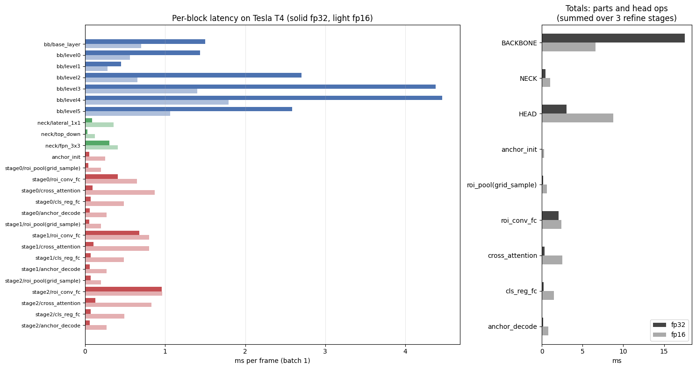
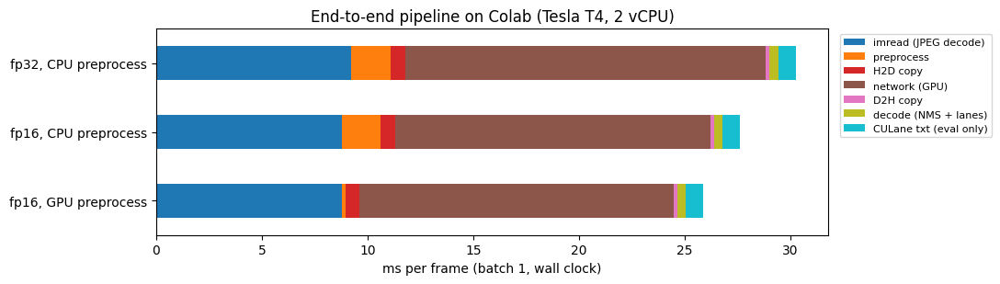
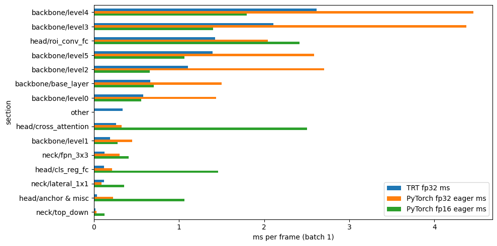
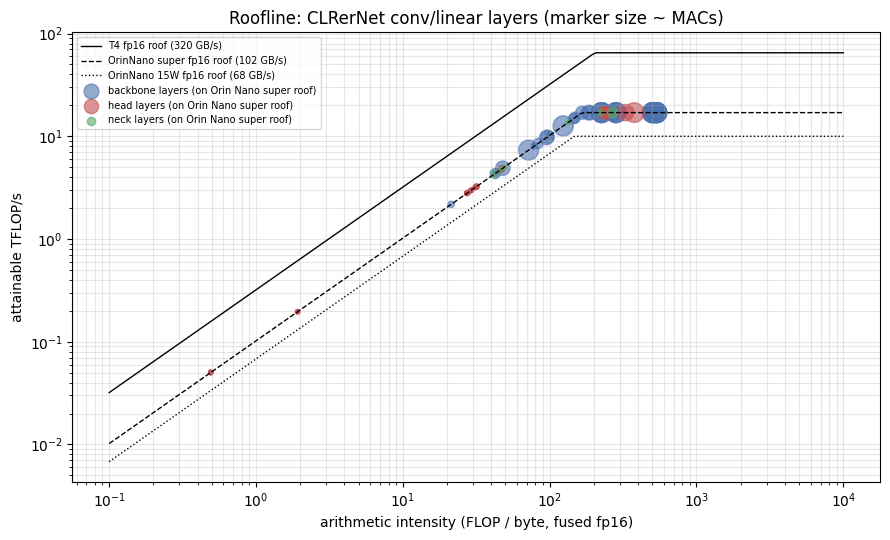
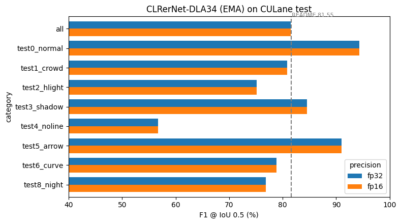
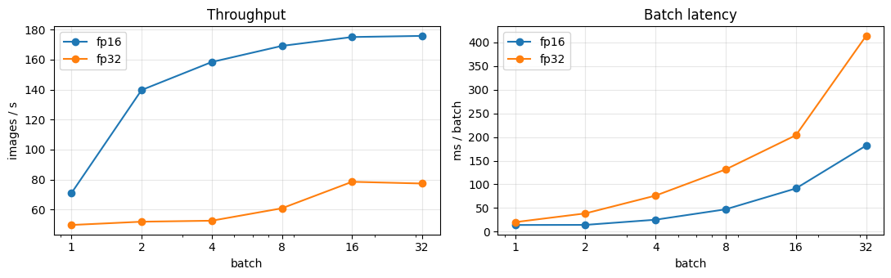
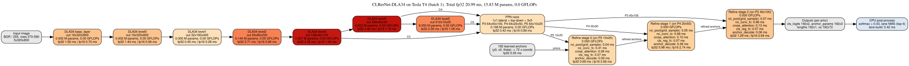
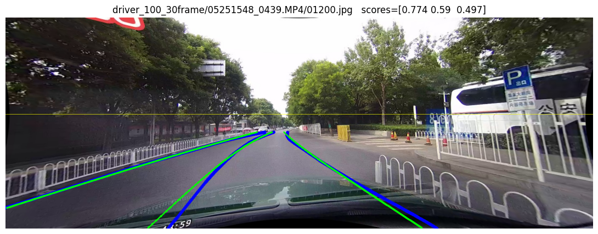

# CLRerNet (DLA34) on CULane: GPU profiling on Google Colab

Evaluation and profiling of the official **CLRerNet⋆ (DLA34 + EMA)** lane detector ([Honda & Uchida, WACV 2024](https://github.com/hirotomusiker/CLRerNet)) on the **CULane test set**, run on a free-tier Google Colab **NVIDIA Tesla T4**. It is the GPU baseline for a later deployment on an **NVIDIA Jetson Orin Nano**.

The notebook measures:
- accuracy (official CULane metric);
- latency (PyTorch eager / CUDA Graph, FP32 / FP16, TensorRT, ONNX Runtime);
- an end-to-end per-frame breakdown;
- the runtime of every part of the network;
- parameters, FLOPs, memory traffic, roofline and peak GPU memory;
- the model graph and an ONNX export.

> **Environment of the reported run:** Tesla T4 (16 GB, sm_75), 2 vCPU, Python 3.13, PyTorch 2.11.0 + CUDA 13.0, cuDNN 9.27, TensorRT 11.4, ONNX Runtime 1.31. Checkpoint: `clrernet_culane_dla34_ema.pth` (release v0.1.0). Input: 3×320×800 (rows 270–590 of the 1640×590 frame).

---

## Results

### Accuracy: CULane test set (34,680 images)

| Metric | FP32 | FP16 (autocast) | Reference (README of CLRerNet) |
|---|---|---|---|
| **F1 @ IoU 0.5** | **81.54** | **81.54** | 81.55 |
| Precision / Recall @ 0.5 | 87.78 / 76.14 | 87.78 / 76.13 | – |
| F1 @ IoU 0.1 | 88.13 | 88.12 | – |
| F1 @ IoU 0.75 | 65.03 | 65.02 | – |

| Category (F1 @ 0.5) | Normal | Crowd | Highlight | Shadow | No line | Arrow | Curve | Night | Cross (FP ↓) |
|---|---|---|---|---|---|---|---|---|---|
| FP32 | 94.35 | 80.85 | 75.17 | 84.51 | 56.75 | 90.99 | 78.88 | 76.85 | 1335 |
| FP16 | 94.35 | 80.85 | 75.13 | 84.54 | 56.75 | 90.99 | 78.88 | 76.85 | 1334 |

The re-implementation reproduces the published checkpoint score. FP16 inference has no measurable accuracy cost.

### Latency: batch 1, Tesla T4

| Backend | Precision | Mean (ms) | p99 (ms) | FPS |
|---|---|---|---|---|
| PyTorch eager | FP32 | 19.56 | 20.35 | 51 |
| PyTorch + CUDA Graph | FP32 | 19.98 | 20.51 | 50 |
| PyTorch eager | FP16 | 14.11 | 20.70 | 71 |
| **PyTorch + CUDA Graph** | **FP16** | **7.44** | **7.58** | **134** |
| **TensorRT 11.4** | **FP32** | **11.20** | – | **89** |
| TensorRT FP16 | FP16 | not measured (see [Known issues](#known-issues)) | | |
| ONNX Runtime CUDA EP | FP32 | 97.39 | 103.16 | 10 (not representative, see [Known issues](#known-issues)) |

- **FP32 is limited by the GPU itself** (GPU 100 % busy, about 560 kernels per frame), so CUDA Graph gives no gain.
- **FP16 is limited by kernel launches** (GPU only about 30 % busy, about 630 kernels per frame). Capturing the forward pass as a CUDA Graph halves the latency. Expect this effect to be stronger on the Jetson's ARM CPU.

### End-to-end per-frame pipeline (ms, batch 1)

| Stage | FP32 | FP16 | FP16 + GPU preprocessing |
|---|---|---|---|
| JPEG decode (`cv2.imread`) | 9.23 | 8.80 | 8.78 |
| Crop + resize + normalise | 1.84 | 1.81 | 0.20 |
| Host → device | 0.70 | 0.68 | 0.64 |
| Network | 17.05 | 14.89 | 14.84 |
| Device → host | 0.19 | 0.18 | 0.18 |
| Decode (softmax, lane NMS, lane build) | 0.42 | 0.40 | 0.41 |
| **Total / FPS** | **29.4 / 34** | **26.8 / 37** | **25.0 / 40** |

JPEG decoding is about a third of the frame time on a 2-vCPU host. On the Jetson, use the hardware JPEG decoder or take frames directly from the camera.

### Where the time goes: per-part runtime (FP32, batch 1)

| Part | Output | PyTorch FP32 (ms) | PyTorch FP16 (ms) | TensorRT FP32 (ms) | Params | GMACs |
|---|---|---|---|---|---|---|
| backbone / base_layer (7×7 conv) | 16×320×800 | 1.50 | 0.70 | 0.67 | 2.4 K | 0.60 |
| backbone / level0 | 16×320×800 | 1.44 | 0.56 | 0.58 | 2.3 K | 0.59 |
| backbone / level1 | 32×160×400 | 0.45 | 0.28 | 0.19 | 4.7 K | 0.30 |
| backbone / level2 | 64×80×200 | 2.71 | 0.66 | 1.11 | 0.14 M | 2.23 |
| **backbone / level3** | 128×40×100 | **4.38** | 1.40 | **2.11** | 1.21 M | 4.82 |
| **backbone / level4** | 256×20×50 | **4.46** | 1.80 | **2.61** | 4.82 M | 4.82 |
| backbone / level5 | 512×10×25 | 2.58 | 1.06 | 1.40 | 9.05 M | 2.26 |
| neck (FPN) | 3 × 64 ch | 0.42 | 0.89 | 0.27 | 0.17 M | 0.25 |
| head, refine stage 0 (on P5 10×25) | 192 priors | 0.68 | 2.47 | | | 0.42 |
| head, refine stage 1 (on P4 20×50) | 192 priors | 0.97 | 2.55 | | | 0.81 |
| head, refine stage 2 (on P3 40×100) | 192 priors | 1.28 | 2.75 | | | 1.21 |
| **Total** | | **≈ 21.0** | **≈ 16.3** | **11.1** | **15.83 M** | **18.3** |

Head breakdown over the 3 stages (FP32): ROI 9×1 convs + FC + LayerNorm 2.05 ms, cross-attention 0.33 ms, ROI pooling (`grid_sample`) 0.16 ms, cls/reg FC 0.21 ms, anchor decode 0.18 ms. In TensorRT FP32 the head totals about 1.8 ms. The per-section TensorRT layer-to-part mapping is approximate for fused layers.

- The **backbone takes about 84 %** of FP32 time; level3 and level4 alone take about 42 %.
- The two **full-resolution layers** (base_layer, level0) hold under 0.1 % of the weights but take about 14 % of the time. They are memory-bound on every GPU considered.
- The FP16 head numbers are inflated by kernel-launch overhead (small kernels at batch 1), not by computation.

### Complexity and memory

| Metric | Value |
|---|---|
| Parameters | 15.83 M (60.4 MB FP32 / 30.2 MB FP16) |
| Compute | 36.6 GFLOPs = **18.3 GMACs** per frame (paper: 18.4, which counts MACs) |
| Memory traffic, eager PyTorch (unfused) | 930 MB FP32 / 587 MB FP16 per frame |
| Memory traffic, fused conv+BN+ReLU (TensorRT-like) | 321 MB FP32 / **161 MB FP16** per frame |
| Peak GPU memory, batch 1 | 252 MB FP32 / 236 MB FP16 (activations 48 / 32 MB) |
| Roofline lower bound, FP16, fused | T4 0.72 ms · Orin Nano Super 2.59 ms · Orin Nano 15 W 4.24 ms |

The roofline lower bound assumes perfect overlap of compute and memory traffic. Real latency will be several times higher. Device figures used: T4 65 TFLOPS FP16 and 320 GB/s; Orin Nano 8 GB 17 / 10 TFLOPS FP16 and 102 / 68 GB/s (Super / 15 W).

### ONNX export

| Check | Result |
|---|---|
| Export | opset 17, static batch 1 and dynamic batch, simplified with onnxslim; 270 nodes, 60.6 MB |
| Ops | Conv 61, Relu 56, Add 24, Gemm 15, GridSample 3, LayerNormalization 3, Softmax 3, Tan 3, Resize 8, … |
| ONNX Runtime vs PyTorch | same decoded lanes on 50/50 images, max lane x difference 0.001 px |
| TensorRT FP32 vs PyTorch | F1@0.5 on a 540-image stratified subset: 80.47 vs 80.47 |

### Figures

| | |
|---|---|
|  |  |
|  |  |
|  |  |

Profiled block diagram (time / FLOPs annotated per block):



Sample prediction (blue = ground truth, green = prediction):



---

## Repository layout

```
notebooks/CLRerNet_CULane_profiling.ipynb   # the Colab notebook, with the outputs of the run reported above
src/clrernet_standalone.py                  # stand-alone PyTorch CLRerNet-DLA34 (inference) + per-section timing hooks
src/clrernet_post.py                        # pre/post-processing, lane NMS (NumPy port), CULane metric
results/*.csv                               # the tables above as CSV
results/figures/                            # plots from the run
```

## Method notes

- **No mmcv/mmdetection.** The official repo targets mmcv 2.x / mmdet 3.3 plus a custom CUDA NMS extension, which have no prebuilt wheels for current Colab PyTorch. `src/clrernet_standalone.py` re-implements the network module-for-module with identical parameter names: all 302 checkpoint tensors load with `strict=True`. The lane NMS is a NumPy port of `libs/models/layers/nms/src/nms_kernel.cu`. Pre-processing, decoding and the metric follow `culane_dataset.py`, `clrernet_head.py`, `lane_utils.py` and `culane_metric.py`.
- **Verification.** An independent NumPy forward pass reproduces the repo's `demo/result.png`. The notebook's self-test compares the PyTorch port against that reference on two test frames (PASS, max score difference 4e-5). The full-test-set F1 (81.54) matches the published 81.55.
- **Per-part timing.** Every block is wrapped in a named section and timed with CUDA events at batch 1. This includes GPU idle time caused by kernel launches, i.e. the real latency of each part. `torch.profiler` traces give the pure kernel-time view.
- **Memory traffic.** "Unfused" counts the bytes read and written by every ATen op (views are free). "Fused" counts, per conv/linear layer, only input + weights + output, approximating TensorRT's conv+BN+ReLU fusion.

## Reproduce

1. Upload to Google Drive:
   - the checkpoint, from the [CLRerNet v0.1.0 release](https://github.com/hirotomusiker/CLRerNet/releases/download/v0.1.0/clrernet_culane_dla34_ema.pth);
   - the CULane test set as **one tar file**, containing `driver_37_30frame/`, `driver_100_30frame/`, `driver_193_90frame/` and `list/` (with `test.txt` and `test_split/`). For example, on Windows: `tar -cf CULane_test_eval.tar -C C:\datasets CULane_test_eval`.

   A single archive copies to the Colab disk in about 5 minutes. Reading the 69 k individual files through the Drive mount is impractically slow.
2. Open `notebooks/CLRerNet_CULane_profiling.ipynb` in Colab and select a T4 GPU. Set `CKPT_PATH` and `CULANE_ARCHIVE` in the config cell, then run all. Results are written to `MyDrive/clrernet_profiling`.

Full run time: about 1.5 h on the free tier. The CPU-bound CULane metric (2 vCPU) takes about 30 min per precision; set `EVAL_SUBSET` for a quick pass.

## Known issues

- **Per-section FLOPs show 0** in the notebook output. The ATen dispatch counter does not match PyTorch 2.11 op names. The model total (FlopCounterMode, 36.6 GFLOPs) and the per-layer MACs (used in the tables above) are correct. Workaround after the per-layer cell: `CPLX["GFLOPs"] = (LAYERS.groupby("section").MACs.sum() * 2 / 1e9).reindex(CPLX.index).fillna(0)`.
- **TensorRT FP16 engine not built.** TensorRT 11 removed `BuilderFlag.FP16` (weakly-typed precision flags). Use `pip install "tensorrt-cu13<11"` in Colab. On the Jetson (JetPack 6.x, TensorRT 10.x), `trtexec --fp16` works.
- **ONNX Runtime CUDA EP (97 ms)** is slower than eager PyTorch, which points to a CUDA EP / CUDA 13 issue in that environment. The value is not used for conclusions; TensorRT is the deployment target.

## Next step: Jetson Orin Nano

```bash
sudo nvpmodel -m 0 && sudo jetson_clocks
/usr/src/tensorrt/bin/trtexec --onnx=clrernet_dla34_culane_ema_b1_op17.onnx --fp16 \
    --saveEngine=clrernet_fp16.engine --useCudaGraph --useSpinWait --warmUp=500 --iterations=1000 \
    --separateProfileRun --dumpProfile --exportProfile=profile_fp16.json \
    --exportLayerInfo=layers_fp16.json --profilingVerbosity=detailed
```

Group `profile_fp16.json` with `group_layer_profile()` from the notebook (section 9) to compare with the per-part table above.

## Credits

- CLRerNet: H. Honda and Y. Uchida, *CLRerNet: Improving Confidence of Lane Detection with LaneIoU*, WACV 2024. Code: [hirotomusiker/CLRerNet](https://github.com/hirotomusiker/CLRerNet) (Apache-2.0). The model, pre/post-processing and metric code in `src/` is adapted from it, which in turn adapts [CLRNet](https://github.com/Turoad/CLRNet), [LaneATT](https://github.com/lucastabelini/LaneATT) and the lane-NMS CUDA kernel by G. Payen de La Garanderie (BSD-3-Clause).
- CULane dataset: X. Pan et al., *Spatial As Deep: Spatial CNN for Traffic Scene Understanding*, AAAI 2018.

```bibtex
@inproceedings{honda2024clrernet,
  title={CLRerNet: Improving Confidence of Lane Detection with LaneIoU},
  author={Honda, Hiroto and Uchida, Yusuke},
  booktitle={Proceedings of the IEEE/CVF Winter Conference on Applications of Computer Vision},
  pages={1176--1185},
  year={2024}
}
```

Part of the [DRTS Lab – Edge AI Optimization](https://github.com/DRTS-Lab-Edge-AI-Optimization) projects.
